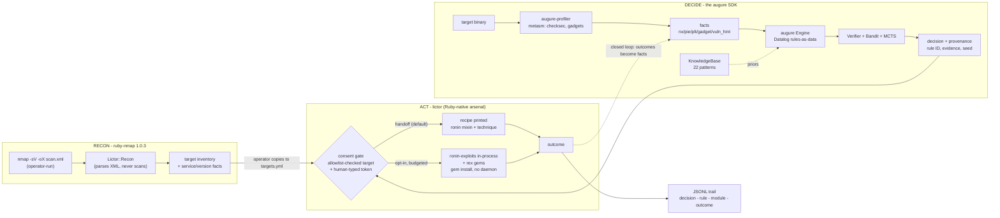

# lictor

**The orchestrator that carries out augure's judgments: nmap, fuzzing,
profiling, execution - consent-gated, trail-everything, handoff by
default.**

> *Lictor (n.): the magistrate's attendant who carried the fasces and
> executed judgments. He did not judge. He executed what was judged.*

[](https://github.com/log0u7/lictor/actions/workflows/ci.yml)
[](https://www.ruby-lang.org/)
[](LICENSE)

**v0.2.0** - pairs with [augure](https://github.com/log0u7/augure), the
auditable exploitation decision layer. augure decides; lictor executes;
nothing escapes the gates.

## Why lictor

Most automation in offensive tooling is a black box: it fires and you
find out why afterwards - or never. lictor inverts that:

- every technique choice comes from a **verified rule with its
  evidence** (augure's explain payload: rule ID, facts, seeded draw);
- every action is **trailed** - one JSONL line, attributable, replayable;
- the dangerous edge - execution - is gated by an **explicit, typed
  human consent**;
- and when no human is in the loop, the default executor is the handoff:
  it prints the recipe and runs nothing.

Solo, deterministic, for pipelines. The same gates when an LLM agent
drives it through MCP. The brakes are not a mode - they are the design.

## The 60-second demo

The lab ships a vulnerable docker target and a tested exploit:

```sh
sh lab/demo.sh
```

The real output:

```
=== 1. scan (nmap, gated, trailed) ===
scanned: 127.0.0.1
127.0.0.1:8000  http (SimpleHTTPServer 0.6)
127.0.0.1:9999  abyss
=== 3. decide (augure: propose, verify, explain) ===
applicable: ret2func
selected:   ret2func
  ret2func <- app_ret2func (vuln=sof, pie=false, target_function=true)
=== 5. run (the closed loop with the ronin executor) ===
status:  success
  ret2func [executed/success]
=== 6. the auditable report ===
- outcome: **success** (ret2func)
```

The chain in full: **scan → acquire → (fuzz → triage) → verify → plan →
authorize → run → outcome → report** - every step trailed, the decision
explained rule-by-rule, the execution consent-gated.

## Capabilities

| Command | What it does |
|---|---|
| `init` / `doctor` | Scaffold the engagement setup; verify the environment (exact fix per check). |
| `scan <host>` | nmap against an allowlisted host - gated, trailed. |
| `acquire <target>` | The nmap → binary bridge: local copy or http download, ELF-checked, profiled, trailed. |
| `fuzz <binary>` | Fuzz + triage a local binary: the fact **discovery** layer. Length sweep + mutations; gdb/rizin/lldb backends. |
| `verify <target>` | The differential: the crash input faults the remote like the local model → the facts become `remote-verified`. |
| `plan <binary-or-facts>` | Profile if ELF, decide (augure), print the recipe. |
| `authorize <target>` | Mint a short-lived execution consent - **typed by the human**. |
| `run <target>` | The closed loop: decide, execute, outcome, re-decide - budgeted. |
| `outcome <run-id>` | Record the result; the next decision adapts the priors. |
| `report` | The auditable engagement report (markdown, provenance included). |
| `rule validate/install/list` | Teach augure a new technique - as data, through the armor. |

## The consent model

There is no consent flag. A flag can be typed by reflex, by a script,
or by anyone with shell access - it proves nothing. The controls are
real artifacts:

1. **The allowlist file is the scope document.** Explicit `host[:port]`
   entries, written and versioned by the operator. Wildcards are
   structurally rejected. Nothing outside the file runs - ever.
2. **Execution requires a consent token** - `lictor authorize <target>`,
   typed by the human, short-lived, recorded in the trail. An agent
   cannot mint one.
3. **Handoff is the default.** `plan` prints the recipe and executes
   nothing; `run` with the ronin executor is opt-in and budgeted.
4. **The trail is append-only.** Decision → rule provenance → action →
   outcome. An engagement you cannot replay is an engagement you cannot
   defend.

## Architecture



## The Ruby-native arsenal

| Need | Gem | Why |
|---|---|---|
| nmap XML parsing | [ruby-nmap 1.0.3](https://rubygems.org/gems/ruby-nmap) (postmodern, 703k dl) | the maintained standard; parses XML without running nmap |
| exploitation runtime | [ronin-exploits 1.1.1](https://rubygems.org/gems/ronin-exploits) + [ronin 2.1.1](https://rubygems.org/gems/ronin) | exploits as Ruby classes, mixins = the technique vocabulary; no daemon, `gem install` |
| primitives | [rex-bin_tools](https://rubygems.org/gems/rex-bin_tools), [rex-arch](https://rubygems.org/gems/rex-arch), [rex-socket](https://rubygems.org/gems/rex-socket) (Rapid7, 2026-maintained) | msf's Ruby internals gemified: ELF/ROP, assembly, raw sockets |
| binary analysis | `augure-profiler` (metasm) | pure Ruby, no subprocess, augure's sibling gem |
| fuzzing | built-in `RubyMutator` (zero-dep) + radamsa optional | the discovery layer for binaries with no write-up |
| persistence | stdlib JSONL | sequel when queries are actually needed |

**Why not Metasploit?** It IS Ruby - but a monolithic Rapid7 app you
must install and drive through a dead RPC gem. `ronin` + `rex` install
as gems and carry the same primitives natively. Metasploit remains an
optional module arsenal behind msfrpcd when a specific ready-made
module is worth the install - but it is not on lictor's critical path.

## The MCP surface: when an LLM agent drives

[lictor-mcp](mcp_server/) exposes four tools over stdio - `scan_target`,
`plan_technique`, `execute_technique`, `validate_pack` - and validates
**server-side**: the allowlist, the consent tokens, the corpus guard.
The agent proposes; augure disposes; lictor executes; the gates hold
either way. Agents teach augure new techniques through the same armor:
see [augure's pack format](https://github.com/log0u7/augure/blob/main/docs/pack-format.md)
and the [augure-operator skill](https://github.com/log0u7/augure/tree/main/skills/augure-operator).

## Acceptable use

Lictor exists for **authorized security work**: engagements with a
signed scope, labs you own, CTF environments. The gates are
load-bearing; bypassing them is the one contribution that will be
rejected on sight. Lictor writes no exploit code - it orchestrates the
operator's chosen tooling; the knowledge lives in the repos, not here.

## Install

Lictor is distributed as a source checkout for a reason: an orchestrator
around pentest tooling has no business being one `gem install` away
from anyone. Bundle it from this repo:

```ruby
# Gemfile
gem "augure"                       # published, clean, MIT
# lictor + lictor-mcp: bundle from your own checkout, private
```

## Documentation

| I want to... | Read |
|---|---|
| run the demo end to end | [the lab](lab/README.md) |
| understand the consent model | [THE RULES in this README](#the-consent-model) |
| see what augure decides and why | [augure's README](https://github.com/log0u7/augure) |
| write the auditability story | [augure's auditability page](https://github.com/log0u7/augure/blob/main/docs/auditability.md) |
| teach augure a technique | [the pack format](https://github.com/log0u7/augure/blob/main/docs/pack-format.md) |

## License

MIT, same as augure.
