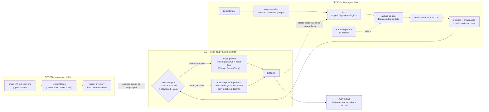

# lictor

**Authorized-ops orchestrator for the augure decision layer.**

> *Lictor (n.): the magistrate's attendant who carried the fasces and
> executed judgments. He did not judge. He executed what was judged.*

**STATUS: scaffold. augure (the decision layer) ships first. Lictor is built
against a stable `augure` gem. Until then, everything here is design.**

---

## THE RULES - read before anything else

Lictor orchestrates reconnaissance and exploitation tooling (nmap, the
Ruby-native arsenal: ronin-exploits + rex gems) against targets. That
capability is gated, in code, not in promises:

1. **No targets without an allowlist.** Every operational mode requires a
   target allowlist file (`targets.yml`) that you wrote, naming hosts you
   are authorized to touch. Wildcards rejected. The tool refuses to run
   against anything not in the file.
2. **No execution without explicit consent.** RPC mode (automated
   execution) requires `--i-am-authorized` on the command line. Not a
   config file, not an env var: a flag typed by a human, per run.
3. **Handoff is the default.** Without the flag, Lictor prints the recipe
   (msfconsole module, options, payload selection) and a human runs it.
   Same decisions, zero automated fire.
4. **Everything is logged.** Decision -> rule -> module -> outcome, one
   line per action, persisted. An engagement you cannot replay is an
   engagement you cannot defend.
5. **Lictor executes; it never decides.** Technique selection belongs to
   [augure](https://github.com/log0u7/augure), the auditable decision
   layer. Lictor feeds it facts and carries out its judgments.

## Not on RubyGems

Lictor is distributed as a source checkout for a reason: an orchestrator
around pentest tooling has no business being one `gem install` away from
anyone. Bundle it from this repo:

```ruby
# Gemfile
gem "augure"                       # published, clean, MIT
# lictor: bundle from your own checkout, private
```

## Architecture



The closed loop: outcomes become facts, augure re-decides, the planner
sees what the leak unlocked. That is the neuro-symbolic pipeline from the
articles - with a consent gate in front of the only dangerous edge.

**Gem choices, verified 2026-10:**

| Need | Gem | Why |
|---|---|---|
| nmap XML parsing | [ruby-nmap 1.0.3](https://rubygems.org/gems/ruby-nmap) (postmodern, 703k dl) | the maintained standard; parses XML without running nmap |
| exploitation runtime | [ronin-exploits 1.1.1](https://rubygems.org/gems/ronin-exploits) (2025-02) + [ronin 2.1.1](https://rubygems.org/gems/ronin) | exploits as Ruby classes, mixins = the technique vocabulary (Binary, FormatString, RemoteTCP); no daemon, `gem install` |
| primitives | [rex-bin_tools 0.1.17](https://rubygems.org/gems/rex-bin_tools), [rex-arch 0.1.20](https://rubygems.org/gems/rex-arch), [rex-socket 0.1.71](https://rubygems.org/gems/rex-socket) (Rapid7, 2026-maintained) | msf's Ruby internals gemified: ELF/ROP tooling, assembly, raw sockets |
| binary analysis | `augure-profiler` (metasm) | pure Ruby, no subprocess, this repo's sibling |
| persistence | stdlib JSONL | sequel when queries are actually needed |

**Why not Metasploit?** It IS Ruby - but a monolithic Rapid7 app you must
install (and drive via the dead 2018 `msfrpc-client` gem or raw msgpack).
`ronin` + `rex` install as gems and carry the same primitives natively.
Metasploit stays available as an optional module arsenal behind msfrpcd
if a specific module is ever needed - but it is no longer on lictor's
critical path.

### The Ruby-native arsenal (is there life beyond msfconsole?)

Yes - and the irony is that Metasploit IS Ruby. Three paths, verified:

1. **[Ronin 2.1](https://rubygems.org/gems/ronin)** - postmodern's toolkit
   (the ruby-nmap author - same ecosystem), last release 2025-02:
   `ronin-exploits` (exploits as Ruby classes, mixins = the technique
   vocabulary), `ronin-payloads`, `ronin-support` (networking, encoding).
   The most Ruby-idiomatic exploitation framework alive. **Default.**
2. **[Rex gems](https://rubygems.org/gems/rex-core)** - Metasploit's Ruby
   internals, gemified and ACTIVELY maintained by Rapid7 (rex-core
   2026-04, rex-arch 2026-05, rex-socket 2026-07, rex-powershell 2026-08,
   rex-bin_tools 2026-08): ELF parsing, ROP tooling, assembler, raw
   sockets, payload generation. The primitives, without the daemon.
3. **Metasploit via msfrpcd** - the optional arsenal of ready-made
   modules, written in Ruby but shipped as a monolithic Rapid7 app.
   Worth the install only when a specific ready-made module is.

Lictor's stance: **ronin + rex are the default arsenal** - `gem install`,
no daemon, no Metasploit tree. Metasploit remains an optional module
arsenal behind msfrpcd when a specific ready-made module is worth the
install. The decision layer (augure) does not care which executor carries
the judgment - the recipe is data.

## Modern require block (what survived 2012)

```ruby
require "augure"          # the decider (Datalog + SMT + bandit + MCTS + explain)
require "nmap/xml"        # recon (ruby-nmap: parses XML, never scans)
require "ronin/exploits"  # the runner: mixins = technique vocabulary (2025-02)
require "rex/bin_tools"   # primitives: ELF + ROP (Rapid7, 2026-maintained)
require "rex/arch"        # assembly primitives
require "sequel"          # persistence: no more lost runs (when queries come)
require "openssl"         # TLS when a remote target is engaged

# Superseded from the aspirational block:
# swipl        -> augure embeds the reasoner
# darwinning   -> dead, unlicensed; the bandit lives in augure
# eventmachine -> dormant since 2018; threads suffice
# msf/core     -> monolithic app; replaced by ronin + rex gems (no daemon)
# msfrpc-client-> dead 2018; msf stays an OPTIONAL arsenal behind msfrpcd
```

## Acceptable use

Lictor exists for **authorized security work**: engagements with a signed
scope, labs you own, CTF environments. The gates are load-bearing; bypassing
them is the one contribution that will be rejected on sight. No
contribution adds exploit code - Lictor orchestrates existing, standard
tooling; the exploit knowledge lives in Metasploit, not here.

## License

MIT, same as augure.
