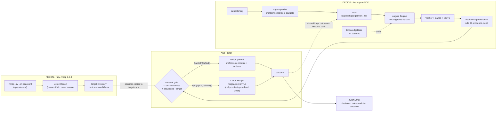

# lictor

**Authorized-ops orchestrator for the augure decision layer.**

> *Lictor (n.): the magistrate's attendant who carried the fasces and
> executed judgments. He did not judge. He executed what was judged.*

**STATUS: scaffold. augure (the decision layer) ships first. Lictor is built
against a stable `augure` gem. Until then, everything here is design.**

---

## THE RULES - read before anything else

Lictor orchestrates reconnaissance and exploitation tooling (nmap, Metasploit
via msfrpcd) against targets. That capability is gated, in code, not in
promises:

1. **No targets without an allowlist.** Every operational mode requires a
   target allowlist file (`targets.yml`) that you wrote, naming hosts you
   are authorized to touch. Wildcards rejected. The tool refuses to run
   against anything not in the file.
2. **No execution without explicit consent.** RPC mode (automated
   execution) requires `--i-am-authorized` on the command line. Not a
   config file, not an env var: a flag typed by a human, per run.
3. **Handoff is the default.** Without the flag, Lictor prints the recipe
   (msfconsole module, options, payload selection) and a human runs it.
   Same decisions, zero automated fire.
4. **Everything is logged.** Decision -> rule -> module -> outcome, one
   line per action, persisted. An engagement you cannot replay is an
   engagement you cannot defend.
5. **Lictor executes; it never decides.** Technique selection belongs to
   [augure](https://github.com/log0u7/augure), the auditable decision
   layer. Lictor feeds it facts and carries out its judgments.

## Not on RubyGems

Lictor is distributed as a source checkout for a reason: an orchestrator
around pentest tooling has no business being one `gem install` away from
anyone. Bundle it from this repo:

```ruby
# Gemfile
gem "augure"                       # published, clean, MIT
# lictor: bundle from your own checkout, private
```

## Architecture



The closed loop: outcomes become facts, augure re-decides, the planner
sees what the leak unlocked. That is the neuro-symbolic pipeline from the
articles - with a consent gate in front of the only dangerous edge.

**Gem choices, verified 2026-10:**

| Need | Gem | Why |
|---|---|---|
| nmap XML parsing | [ruby-nmap 1.0.3](https://rubygems.org/gems/ruby-nmap) (postmodern, 703k dl) | the maintained standard; parses XML without running nmap |
| Metasploit RPC | raw `msgpack` 1.8.5 (524M dl, maintained 2026-09) | `msfrpc-client` gem is dead (last release 2018); the RPC protocol is msgpack over HTTP/SSL, ~100 LOC |
| binary analysis | `augure-profiler` (metasm) | pure Ruby, no subprocess, this repo's sibling |
| persistence | stdlib JSONL | sequel when queries are actually needed |

### The Ruby-native arsenal (is there life beyond msfconsole?)

Yes - and the irony is that Metasploit IS Ruby. Three paths, verified:

1. **Metasploit via msfrpcd** - the arsenal of ready-made modules, written in
   Ruby, reachable through its RPC daemon. Not gemifiable (monolithic
   Rapid7 app), hence the subprocess/RPC boundary. Biggest coverage.
2. **[Rex gems](https://rubygems.org/gems/rex-core)** - Metasploit's Ruby
   internals, gemified and ACTIVELY maintained by Rapid7 (rex-core
   2026-04, rex-arch 2026-05, rex-socket 2026-07, rex-powershell 2026-08,
   rex-bin_tools 2026-08): ELF parsing, ROP tooling, assembler, raw
   sockets, payload generation. A pure-Ruby arsenal without the daemon.
3. **[Ronin 2.1](https://rubygems.org/gems/ronin)** - postmodern's toolkit
   (the ruby-nmap author - same ecosystem), last release 2025-02:
   `ronin-exploits` (exploits as Ruby classes), `ronin-payloads`,
   `ronin-support` (networking, encoding). The most Ruby-idiomatic
   exploitation framework alive.

Lictor's stance: **msfrpcd stays the default arsenal** (module coverage),
and the handoff recipe format gains `ronin`/`rex` targets when the lab
phase starts. The decision layer (augure) does not care which executor
carries the judgment - the recipe is data.

## Modern require block (what survived 2012)

```ruby
require "augure"        # the decider (Datalog + SMT + bandit + MCTS + explain)
require "nmap/program"  # recon -> facts (ruby-nmap, maintained)
require "nmap/xml"
require "msgpack"       # msfrpcd RPC (msfrpc-client gem is dead; ~100 LOC)
require "sequel"        # persistence: no more lost runs
require "openssl"       # TLS for the RPC channel
# documented future paths (Ruby-native arsenal, see table above):
# require "rex/bin_tools"  # ELF + ROP, Rapid7-gemified, 2026-maintained
# require "ronin/exploits" # exploits as Ruby classes, 2025-02

# Superseded from the aspirational block:
# swipl        -> augure embeds the reasoner
# darwinning   -> dead, unlicensed; the bandit lives in augure
# eventmachine -> dormant since 2018; threads suffice
# msf/core     -> not a gem; msfrpcd is the boundary, never in-process
```

## Acceptable use

Lictor exists for **authorized security work**: engagements with a signed
scope, labs you own, CTF environments. The gates are load-bearing; bypassing
them is the one contribution that will be rejected on sight. No
contribution adds exploit code - Lictor orchestrates existing, standard
tooling; the exploit knowledge lives in Metasploit, not here.

## License

MIT, same as augure.
