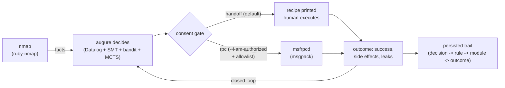

# lictor

**Authorized-ops orchestrator for the augure decision layer.**

> *Lictor (n.): the magistrate's attendant who carried the fasces and
> executed judgments. He did not judge. He executed what was judged.*

**STATUS: scaffold. augure (the decision layer) ships first. Lictor is built
against a stable `augure` gem. Until then, everything here is design.**

---

## THE RULES - read before anything else

Lictor orchestrates reconnaissance and exploitation tooling (nmap, Metasploit
via msfrpcd) against targets. That capability is gated, in code, not in
promises:

1. **No targets without an allowlist.** Every operational mode requires a
   target allowlist file (`targets.yml`) that you wrote, naming hosts you
   are authorized to touch. Wildcards rejected. The tool refuses to run
   against anything not in the file.
2. **No execution without explicit consent.** RPC mode (automated
   execution) requires `--i-am-authorized` on the command line. Not a
   config file, not an env var: a flag typed by a human, per run.
3. **Handoff is the default.** Without the flag, Lictor prints the recipe
   (msfconsole module, options, payload selection) and a human runs it.
   Same decisions, zero automated fire.
4. **Everything is logged.** Decision -> rule -> module -> outcome, one
   line per action, persisted. An engagement you cannot replay is an
   engagement you cannot defend.
5. **Lictor executes; it never decides.** Technique selection belongs to
   [augure](https://github.com/log0u7/augure), the auditable decision
   layer. Lictor feeds it facts and carries out its judgments.

## Not on RubyGems

Lictor is distributed as a source checkout for a reason: an orchestrator
around pentest tooling has no business being one `gem install` away from
anyone. Bundle it from this repo:

```ruby
# Gemfile
gem "augure"                       # published, clean, MIT
# lictor: bundle from your own checkout, private
```

## Architecture



The closed loop: outcomes become facts, augure re-decides, the planner
sees what the leak unlocked. That is the neuro-symbolic pipeline from the
articles - with a consent gate in front of the only dangerous edge.

## Modern require block (what survived 2012)

```ruby
require "augure"        # the decider (Datalog + SMT + bandit + MCTS + explain)
require "nmap/program"  # recon -> facts (ruby-nmap, maintained)
require "nmap/xml"
require "msgpack"       # msfrpcd RPC (msfrpc-client gem is dead; ~100 LOC)
require "sequel"        # persistence: no more lost runs
require "openssl"       # TLS for the RPC channel

# Superseded from the aspirational block:
# swipl        -> augure embeds the reasoner
# darwinning   -> dead, unlicensed; the bandit lives in augure
# eventmachine -> dormant since 2018; threads suffice
# msf/core     -> not a gem; msfrpcd is the boundary, never in-process
```

## Acceptable use

Lictor exists for **authorized security work**: engagements with a signed
scope, labs you own, CTF environments. The gates are load-bearing; bypassing
them is the one contribution that will be rejected on sight. No
contribution adds exploit code - Lictor orchestrates existing, standard
tooling; the exploit knowledge lives in Metasploit, not here.

## License

MIT, same as augure.
