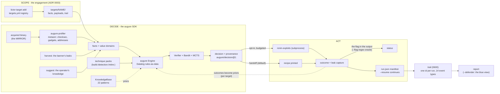

# lictor


**The orchestrator that carries out augure's judgments: nmap, fuzzing,
profiling, execution - every action recorded, handoff by default.**

> *Lictor (n.): the magistrate's attendant who carried the fasces and
> executed judgments. He did not judge. He executed what was judged.*

[](https://github.com/log0u7/lictor/actions/workflows/ci.yml)
[](LICENSE)
[](https://www.ruby-lang.org/)
[](https://rubygems.org/gems/lictor)
[](https://nmap.org)
[](https://modelcontextprotocol.io)
[](https://jsonlines.org)

**v0.3.0** - pairs with [augure](https://github.com/log0u7/augure), the
auditable exploitation decision layer. augure decides; lictor executes;
the trail records everything.

> **Authorized use only.** This tool is for legally authorized security
> assessments and CTF labs. You are the operator: what it does, you
> did. Know the law where you stand.

## Why lictor

Most automation in offensive tooling is a black box: it fires and you
find out why afterwards - or never. lictor inverts that:

- every technique choice comes from a **verified rule with its
  evidence** (augure's explain payload: rule ID, facts, seeded draw);
- every action is **trailed** - one JSONL line, attributable, replayable;
- the dangerous edge - execution - is opt-in: the default executor is
  the handoff, which prints the recipe and runs nothing.
- the mirror is the analysis target: the scan identifies, the local
  reproduction gets profiled and built against, `verify` proves the
  remote faults like the local model.

Equally strict when an LLM agent drives it through MCP. The brakes are
not a mode - they are the design.

## The 60-second demo


Replay it yourself against the lab:

```sh
sh lab/demo.sh
```

The full chain is: **scan → acquire/mirror → (fuzz → triage) →
verify → suggest → harvest → plan → build → run → outcome → report**,
every step recorded in the trail (one stable run id, the manifest
written per attempt), the decision explained rule-by-rule.
`harvest` reads the service banner's hex leaks into `leaked_address`
facts; `suggest` is the agent's own step
`suggest` is the agent's own step: propose observations as facts, get
the decision delta back
(see [docs/how-to-llm-suggestions.md](docs/how-to-llm-suggestions.md));
`build` is the payload step: the offset is measured, the bytes are
assembled (below). When discovery finds NO exploit for the decided
technique, the run scaffolds it and the next attempt uses it; when NO
technique applies to the crash, `lictor draft` writes a staged pack
from the observations - the loop feeds augure back.

## Named targets: the engagement model

State is scoped per target (ADR 0003), not clobbered in the CWD:

```sh
lictor target add web01 10.0.0.5:9999 --from http://10.0.0.5:8000/binary
lictor --target web01 acquire web01     # or: acquire web01 --target web01
lictor --target web01 plan              # reads targets/web01/target.facts
lictor --target web01 run web01 --facts targets/web01/target.facts \
  --executor ronin --flag-regex "FLAG\{[^}]+\}"
lictor run ... --resume <run-id>        # the manifest is written per attempt:
                                        # an interruption is a pause, not an orphan
```

`targets/<name>/` holds the facts, the payloads and the trail; the
registry is `targets.yml`. Priors are per-target by construction (the
scoped trail IS the scope): a failure on A does not shift B's
decisions.

The same loop exports as a BENCH: `sh lab/bench.sh` renders the
engagement's trail as `lictor/bench@1` - the tasks/actions/feedback
telemetry the LLM benchmarks read (NYU CTF Bench, InterCode). The
agent proposes, augure disposes, lictor executes, and the whole run
is the measurement.

## From decision to payload: the offset is measured, not guessed

`lictor build` carries the original tool's inheritance - with every
number auditable instead of assumed:

- the **offset is measured**: the frame read statically (ret2win x64 =
  40, the canonical number) or the cyclic pattern crashed under the
  debugger - never a magic constant;
- the **return address comes from the facts**: the winning symbol's
  address, the gadget facts, or the addresses the service's own banner
  leaked (`lictor harvest`);
- the **shellcode is assembly source** (execve, bash -p, the orw chain
  for seccomp targets) assembled on demand by metasm - no hex blobs;
- the result is a payload file the trail records and `lictor run
  --payload` sends as-is. When the flag does not come, the exploit says
  so and the run says failed.

```sh
lictor build ret2func --facts target.facts -o payload.bin
# technique:  ret2func
# offset:     16  (measured)
# ret:        win_symbol:win@4198870
# payload:    payload.bin (24 bytes, arch x64)
lictor run 127.0.0.1:9999 --facts target.facts \
  --executor ronin --payload payload.bin
```

The slot vocabulary, the metasm usage step by step, and the published
lineage (metasm SSTIC 2007 -> the SSTIC 2008 deprotection paper ->
esec-lab 2010 -> miasm 2012 -> the 2015 ghost-writing technique) live
in [augure/docs/build-format.md](../augure/docs/build-format.md).

## Capabilities

| Command | What it does |
|---|---|
| `target add / list` | Named targets: a dir per target (facts, payloads, its own trail) + the `targets.yml` registry; `--target` scopes every command. |
| `init` / `doctor` | Scaffold the engagement setup; verify the environment (exact fix per check; gdb/ronin/docker as warns). |
| `recon <nmap.xml>` | Print the service candidates from an nmap XML (passive, never scans). |
| `runs` | List the trailed runs. |
| `scan <host>` | nmap against a target; the scan is recorded. |
| `acquire <target>` | The lab convenience: copy or download the binary when the target serves it. The real flow is the MIRROR (below). |
| `fuzz <binary>` | Fuzz + triage a local binary: the fact **discovery** layer. Length sweep + mutations; gdb/rizin/lldb backends. |
| `verify <target>` | The differential: the crash input faults the remote like the local model → the facts become `remote-verified`. |
| `harvest <target>` | The banner's hex leaks become `leaked_address` facts - `--facts PATH` appends them. |
| `plan <binary-or-facts>` | Profile if ELF, decide (augure), print the recipe. |
| `build <binary>` | Assemble the payload for the selected technique: measured offset (cyclic pattern under the debugger), fact-sourced return address, metasm-assembled shellcode. Layouts cover the ROP chains (`chain` slots resolve `gadget:`/`plt_addr:`/`got_addr:`/`leak:`/`const:` refs from the facts, loud `BuildError` on any missing piece); under seccomp the `sh` stub switches to the orw chain. |
| `suggest <facts>` | The agent proposes observations as facts; augure re-decides and the delta comes back - `-o PATH` writes the merged base, so the enrichment is not a dry run. |
| `draft <facts>` | No technique applies? The observed facts + the measured constants draft a PACK in the staging dir, armor-validated, for the operator to review and install. |
| `exploit scaffold <technique>` | Draft the ronin exploit for a decided technique: the measured constants embedded, the payload loader wired - review, commit, run. |
| `run <target>` | The closed loop: decide, execute, outcome, re-decide - with an attempt budget, `--flag-regex` as the success oracle (the flag in the output, not the exit code), the leak capture (the output's hex addresses become facts for the next attempt) and the run manifest (`--resume <id>` continues an interrupted run). |
| `outcome <run-id>` | Record the result; the next decision adapts the priors. |
| `report` | The auditable engagement report (markdown, provenance included) - `--defender` renders the blue-side view: the action timeline + the packs' `detection:` hints. |
| `rule validate/install/list` | Teach augure a new technique - as data, through the armor. |

## The operator is the authorization

No gates, no tokens. You decide what to target; the trail records what
was done:

1. **Handoff is the default.** `plan` prints the recipe and executes
   nothing; `run` with the ronin executor is opt-in and budgeted.
2. **The trail is append-only.** Decision → rule provenance → action →
   outcome. An engagement you cannot replay is an engagement you cannot
   defend.
3. **The mirror is the analysis target.** The scan identifies
   (service + version); when the remote cannot be profiled, you stand
   up the SAME service locally - your package, your install - and
   lictor scans+profiles the mirror, builds on its facts, and `verify`
   proves the remote faults like the local model before anything runs
   for real.

## Architecture



## The Ruby-native arsenal

| Need | Gem | Why |
|---|---|---|
| nmap XML parsing | [ruby-nmap 1.0.3](https://rubygems.org/gems/ruby-nmap) (postmodern, 703k dl) | the maintained standard; parses XML without running nmap |
| exploitation runtime | [ronin-exploits 1.1.1](https://rubygems.org/gems/ronin-exploits) + [ronin 2.1.1](https://rubygems.org/gems/ronin) | exploits as Ruby classes, mixins = the technique vocabulary; no daemon, `gem install` |
| binary analysis | `augure-profiler` (metasm) | pure Ruby, no subprocess, augure's sibling gem |
| fuzzing | built-in `RubyMutator` (zero-dep) + radamsa optional | the discovery layer for binaries with no write-up |
| persistence | stdlib JSONL | sequel when queries are actually needed |

**Why not Metasploit?** It IS Ruby - but a monolithic Rapid7 app you
must install and drive through a daemon. Lictor's path is gems: ronin
installs as a gem and runs as a subprocess, nothing to daemonize. A
ready-made msf module is fine for the operator's hands - it is just
not on lictor's critical path.

## The MCP surface: when an LLM agent drives

[lictor-mcp](mcp_server/README.md) exposes seven tools over stdio - `scan_target`,
`plan_technique`, `execute_technique`, `suggest_facts`, `build_payload`,
`scaffold_exploit`, `validate_pack` -
and validates
**server-side**: the armor, the corpus guard, the trail.
The agent proposes; augure disposes; lictor executes - and the checks
run server-side, so the agent cannot weaken them. Agents teach augure new techniques through the same armor:
see [augure's pack format](https://github.com/log0u7/augure/blob/main/docs/pack-format.md)
and the [augure-operator skill](https://github.com/log0u7/augure/tree/main/skills/augure-operator).

## Honest numbers

Read every claim below as a **prediction with provenance**, not a field
result - the lab is the measurement bench, not the world:

| Claim | Evidence |
|---|---|
| ret2func: the built payload lands the real flag, no brute-force | the lab, e2e: build (offset 16 measured) → run → `FLAG{augure_decides_lictor_executes}` |
| the offset measurement generalizes | static frame read (ret2win x64 = 40, the canonical number) + the cyclic pattern under the debugger, cross-validated on the same binaries |
| a missing exploit drafts itself | the run's auto-scaffold: discovery empty + binary in hand -> the exploit file lands in the repo, the next attempt uses it |
| an unknown crash becomes a pack | `lictor draft`: the observed facts + the measured constants -> an armor-validated pack in the staging dir |
| corpus: 33/33 technique classifications | `augure-benchmark`, CI-enforced at 100% |
| the eight-target lab, seven deterministic end-to-end | the lab: ret2func/ret2plt/shellcode/fmtstr/orw land the flag via `run` (orw reads its own flag, not the shared one); ret2plt's chain rides the read channel - the copy is bounded by the read length so NUL-bearing addresses cross, rdi aims the service's own command string, 30/30 connections - and the oracle is the target's own flag; the ROP Emporium pair (callme, ret2csu) joins through packs: callme's pop_rsi_r15 pattern and the csu popper aimed at the epilogue (not the symbol entry), an import emits no win_symbol; uaf_heap decides and hands off loyally |
| the hardening matrix predicts its own death | `lab/purple.sh`: the hardened mirrors (canary+PIE+RELRO+FORTIFY) + `augure coverage` flips - the decision's applicable set shrinks as documented |
| MEASURED against a typed-decision classifier (Laya, open weights, the fact text as state, the 16 heads as choices): augure **5/5** at 8.5 ms (warm, MCTS included); the classifier 1/5, confident-and-wrong (0.93-0.98 confidence on its errors) - the global-prior bias, reproduced by a 2026 model | `pappers/laya-bench.py`, measured on CPU (i7 8-core, torch) |

A run that fails says failed: `--flag-regex` makes the flag in the
output the success oracle (the exit code lies both ways), and the
manual executor hands off instead of pretending.

## Acceptable use

Lictor exists for **authorized security work** (you are responsible for the legality where you stand): engagements with a
signed scope, labs you own, CTF environments. The authorization model
is load-bearing; bypassing it is the one contribution that will be
rejected on sight. Lictor writes no exploit code - it orchestrates the
operator's chosen tooling; the knowledge lives in the repos, not here.

## Install

Published on rubygems:

```sh
gem install lictor          # the orchestrator
gem install lictor-mcp      # the MCP server surface
```

augure and augure-profiler install the same way (`gem install augure
augure-profiler`); the gems carry the decision layer, the profiler and
the engine, not the knowledge: the technique packs and the exploits
live in the repositories, `bin/lictor` in a checkout stays the source
of truth for the lab and the pack drafts. The operator model is
unchanged: nothing executes without the operator's own target, the
handoff mode is the default, the closed loop is opt-in.

## Documentation

The architectural decisions are recorded as ADRs in
[docs/adr/](docs/adr/): the Tube as the transport seam (0001), verify as
the arithmetic check with SMT a seam not a promise (0002), engagement
state as a directory per target, no database (0003).

| I want to... | Read |
|---|---|
| run the demo end to end | [the lab](lab/README.md) |
| understand the operator model | [the operator section](#the-operator-is-the-authorization) |
| see what augure decides and why | [augure's README](https://github.com/log0u7/augure) |
| write the auditability story | [augure's auditability page](https://github.com/log0u7/augure/blob/main/docs/auditability.md) |
| teach augure a technique | [the pack format](https://github.com/log0u7/augure/blob/main/docs/pack-format.md) |

## License

MIT, same as augure.
